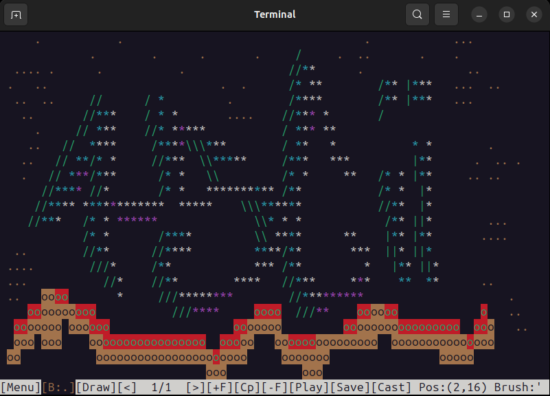

# 4scii - Terminal ASCII Art & Frame-by-Frame Animator

`4scii` is a mouse-driven terminal ASCII art paint program and frame-by-frame animation editor built with `curses`/`ncurses` in C. It supports full 8x8 ANSI color pairs, bold attributes, per-frame Undo/Redo stacks, onion-skinning, ANSI-colored static `.txt` file load/save, and full **asciinema v2 (`.cast`)** animation import and export.

## Features

- **Mouse-Driven Painting & Erasing:** Click and drag to paint characters with active foreground/background colors, or toggle erase mode.
- **Interactive Control & Color Menu:** Popup `ncurses` menu accessible via mouse or keyboard to select colors, brush presets, frame timing, onion-skinning, and file operations.
- **Frame-by-Frame Animator:** Create blank frames, duplicate existing frames for incremental animation, delete frames, adjust per-frame millisecond delays, toggle dim blue onion-skinning of the previous frame, and preview live animation playback in the terminal.
- **Colored `.txt` I/O (Save & Save As):** Save and load cropped static ASCII art files with full ANSI SGR color and bold preservation (compatible with `cat`, `less -R`, and plain uncolored `.txt` files). Supports quick `Save` to the active file as well as `Save As`.
- **Asciinema `.cast` v2 Import & Export:** Load and edit existing `.cast` animations or export multi-frame color animations with exact frame timings playable via `asciinema play`.
- **Readline-Style Filename Prompts:** In-place cursor editing, kill/yank ring, session history, and filesystem `Tab` completion for all file prompts.

## Grab the Source

```sh
git clone https://github.com/aladrin/4scii.git
cd 4scii
```
---

## Dependencies & Build

### Prerequisites

- **Debian / Ubuntu:**
  ```sh
  sudo apt-get install build-essential libncurses-dev
  ```
- **Rocky Linux / RHEL / Fedora:**
  ```sh
  sudo dnf install gcc make ncurses-devel
  ```
- **OpenBSD:**
  Ensure the base `comp` set is installed (`curses` is in base) and install GNU Make (`gmake` is required to build):
  ```sh
  doas pkg_add gmake
  ```
- **macOS:**
  Install the Xcode Command Line Tools (provides `clang`, `make`, and system `ncurses` headers and libraries):
  ```sh
  xcode-select --install
  ```
- **Windows (WSL / WSL2):**
  1. If WSL is not yet installed, open PowerShell or Command Prompt as Administrator and run:
     ```powershell
     wsl --install
     ```
  2. Inside your WSL terminal (Ubuntu/Debian default), install the compiler toolchain and `ncurses` headers:
     ```sh
     sudo apt-get update && sudo apt-get install -y build-essential libncurses-dev
     ```
  3. Run `4scii` inside **Windows Terminal** (or another `xterm`-compatible terminal emulator) so mouse button-motion tracking (`xterm-1002`) works when clicking and dragging across the canvas.

### Configure and Compile

Run `./configure` to detect your compiler and `curses`/`ncurses` headers and libraries, then build with `make` (Linux / macOS / WSL) or `gmake` (OpenBSD):

```sh
./configure

# Linux / macOS / WSL:
make

# OpenBSD:
gmake
```

To clean build artifacts:

```sh
# Linux / macOS / WSL:
make clean      # Remove binary and object files
make distclean  # Remove binary, object files, and config.mk

# OpenBSD:
gmake clean
gmake distclean
```

## Usage

Start with a blank canvas, or pass an existing `.txt` static file or `.cast` animation file to load on startup:

```sh
./4scii
./4scii artwork.txt
./4scii animation.cast
```

### Mouse Controls

| Action | Description |
| :--- | :--- |
| **Left-Click / Drag (Canvas)** | Paint with the current brush and colors (or erase in Erase mode) |
| **Middle-Click (Canvas)** | Toggle between `Draw` and `Erase` modes |
| **Right-Click (Canvas)** | Open the interactive `4scii` Control & Color Menu |
| **Left-Click (Bottom Toolbar)** | Trigger toolbar buttons (`[Menu]`, `[B:*]`, `[Draw]`, `[<]`, `[>]`, `[+F]`, `[Cp]`, `[-F]`, `[Play]`, `[Save]`, `[SvAs]`, `[Cast]`) |

### Keyboard Shortcuts (Canvas)

| Key | Action |
| :--- | :--- |
| **Any Printable Key** | Set active brush character (`*`, `#`, `@`, letters, symbols, etc.) |
| **Left / Right Arrows** | Cycle Foreground (FG) color |
| **Up / Down Arrows** | Cycle Background (BG) color |
| **Page Up / Page Down** | Step to Previous / Next animation frame |
| **F2 / Tab / Ctrl+G** | Open the interactive Control & Color Menu |
| **Ctrl+N** | Insert a new blank frame after the current frame |
| **Ctrl+D** | Duplicate/clone the current frame into a new frame |
| **Delete / Ctrl+X** | Delete the current frame (or clear if it is the only frame) |
| **Ctrl+K** | Clear the current frame |
| **Ctrl+Z** | Undo stroke/edit on the current frame |
| **Ctrl+Y** | Redo stroke/edit on the current frame |
| **Ctrl+P** | Play / preview animation loop in the terminal (press any key or click to stop) |
| **Ctrl+S** | Quick save current frame to active `.txt` file (prompts on first save) |
| **Ctrl+A** | Save As — prompt for a new `.txt` or `.cast` filename |
| **Ctrl+O / Ctrl+L** | Prompt for filename and load `.txt` or `.cast` file (auto-detected by extension) |
| **Ctrl+R** | Prompt for filename and load an asciinema `.cast` animation |
| **Ctrl+E** | Prompt for filename and export full animation as asciinema `.cast` |
| **Ctrl+Q** | Quit `4scii` |

### Filename Prompt Controls (Readline-Style)

When entering a filename for `Save`, `Save As`, `Load`, or `Export .cast`:

| Key | Action |
| :--- | :--- |
| **Tab** | Filesystem path and filename completion (displays candidate list on multiple matches) |
| **Left / Right (`Ctrl+B` / `Ctrl+F`)** | Move cursor left / right within the filename |
| **Home / End (`Ctrl+A` / `Ctrl+E`)** | Jump to start / end of the line |
| **Up / Down (`Ctrl+P` / `Ctrl+N`)** | Cycle through previously entered filenames in session history |
| **Backspace / `Ctrl+H`** | Delete character before the cursor |
| **Delete / `Ctrl+D`** | Delete character under the cursor |
| **`Ctrl+K` / `Ctrl+U`** | Kill from cursor to end / start of line (saved to yank buffer) |
| **`Ctrl+W`** | Kill previous word or path segment (saved to yank buffer) |
| **`Ctrl+Y`** | Yank (paste) last killed text at the cursor |
| **`Ctrl+T`** | Transpose characters around the cursor |
| **Enter** | Confirm filename |
| **ESC / `Ctrl+G`** | Cancel prompt |

### Menu Controls (`F2` / `Tab` / `Right-Click`)

Inside the popup menu, you can click any control with the mouse or use single-key shortcuts:
- **`1`–`8` or `Left` / `Right`:** Select or cycle Foreground color
- **`F` / `G` or `Down` / `Up`:** Cycle Background color
- **`B`:** Toggle Bold attribute
- **`M`:** Toggle `Draw` / `Erase` mode
- **`C`:** Type a custom brush character
- **`,` / `.` or `Page Up` / `Page Down`:** Previous / Next frame
- **`N` / `D` / `X` (or `Del`):** New blank frame / Duplicate frame / Delete frame
- **`-` / `+`:** Decrease / Increase frame duration (`+/- 20ms`)
- **`O`:** Toggle Onion-Skinning (dims previous frame in blue behind current frame)
- **`P`:** Play animation
- **`Z` / `Y` / `K`:** Undo / Redo / Clear current frame
- **`S` / `A`:** Quick Save `.txt` / Save As (`.txt` or `.cast`)
- **`L` / `I` / `E`:** Load (`.txt` or `.cast`) / Load `.cast` / Export `.cast`
- **`ESC` / `F2` / `Q` / `Enter`:** Close menu and return to canvas

## Viewing Saved Files

Static colored ASCII art files saved as `.txt` include ANSI SGR color sequences and can be displayed directly in the terminal:

```sh
cat 4scii.txt
```

Animations exported as `.cast` use the **asciinema v2** format and can be replayed with the `asciinema` CLI or reopened in `4scii`:

```sh
asciinema play 4scii.cast
./4scii 4scii.cast
```
